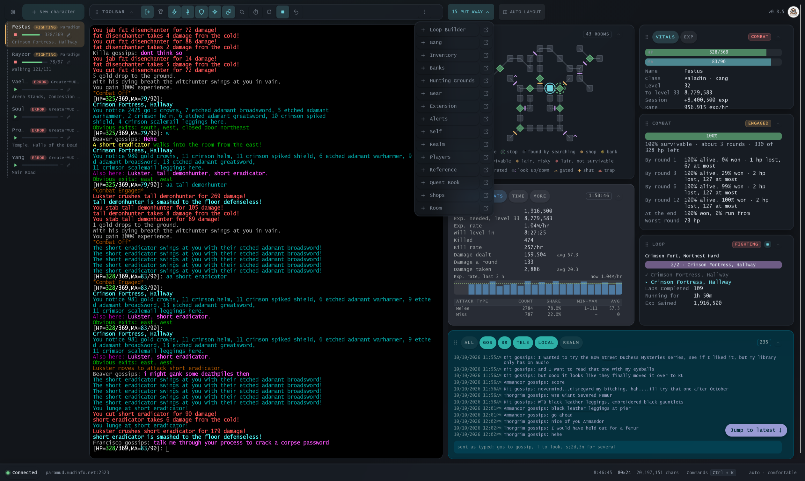

# mudengine

A client for MajorMUD, GreaterMUD and Paradigm. It has a terminal, a map, live
cards and scripting, and covers what MegaMUD does.



| | |
|---|---|
| Games | MajorMUD, GreaterMUD, Paradigm |
| Runs on | Windows, macOS (Intel and Apple Silicon), Linux, or in a browser through Docker |
| World data | MajorMUD and Paradigm built in, or load your realm's own `.mdb` |
| Realms included | Paradigm's six (game 1 to 4, test PvE, test PvP) |
| Version | 0.8.5, played daily on live realms |

## Contents

- [The screen](#the-screen)
- [Cards](#cards)
- [Scripting](#scripting)
- [Walking, loops and goto](#walking-loops-and-goto)
- [Trips](#trips)
- [Remote control](#remote-control)
- [More than one character](#more-than-one-character)
- [Settings and files](#settings-and-files)
- [Getting started](#getting-started)
- [Running it in Docker](#running-it-in-docker)

## The screen

| Part | What it does |
|---|---|
| Terminal | The game as the server sends it, in the original ANSI colours and CP437 font. Search the backscroll, load older lines, show a time on each line. |
| Character tabs | One tab per character. The tab shows what it is doing (fighting, resting, walking 121/131, looping, poisoned, held, offline) and a connect button. |
| Toolbar | Buttons for every `Auto-` switch, loops, and movement. Pin the ones you use. |
| Cards | Panels around the terminal. Drag, resize, dock above or below, or float them over the terminal. **Auto layout** sizes each card to fit. |
| Command palette | `Ctrl+Shift+K`. Type a command, a room to goto, a monster or item to look up, or a card to show. |
| Themes | 27 themes, dark and light, such as Dracula, Nord, Gruvbox, Solarized and Vivid VGA. The terminal stays black. |

## Cards

Each card reads what the server prints and updates as you play. You do not
have to type `st` or `i` over and over.

### Your character

| Card | Shows |
|---|---|
| Vitals | HP and mana (or kai) bars, class, level, exp to next level, session exp and exp rate. The Exp tab has the full level table. |
| Self | Your stat sheet: stats, skills, lives/CP, AC/DR, MR, light source and supplies that are running low. |
| Inventory | What you are carrying, coins by type, weight and keys. |
| Gear | The best item for each slot anywhere in the realm, what you can afford now, and a trip to go buy it. |
| Banks | Your balance at every bank you have used. |

### Fighting

| Card | Shows |
|---|---|
| Combat | Your target, how hurt it is, what is on you, and the odds: chance to survive, rounds to kill, HP left at the end. |
| Combat Stats | Exp rate, kills per hour, time to level, damage dealt and taken, hit and miss rates per attack type, and an exp graph for the last two hours. |
| Hunting Grounds | Every lair you can reach, rated for this character, best first. Lairs that are too hard or too easy are listed with the reason. |
| Party | Members' HP and mana, their rank, who is fighting what, and invites. |

### The world

| Card | Shows |
|---|---|
| Map | The rooms around you from the world database. Lairs, shops, banks, gates, traps and secret exits are marked. Click a room to goto it. |
| Room | The room you are in and what is here. Shops, banks, temples and trainers get extra detail. |
| Loop Builder | Click rooms on the map to draw a loop and save it. |
| Navigation | The route or loop you are on, its progress, and stop or resume. |
| Shops | Every shop list you have seen, searchable, with a route to each shop. |
| Quest Book | The realm's quests: who can do them, each step, and the route for each step. |
| Reference | Look up any monster, item or spell: HP, drops, price, AC/DR, spell cost and level. |

### People and talk

| Card | Shows |
|---|---|
| Talk | Gossip, auction, broadcast, telepaths, gangpath, say and yell, each on its own tab with a search field. You can type into it. |
| Realm | The `who` list, which you can filter by alignment. |
| Players | Everyone you have seen on the realm, where they were last seen, and their `@health` replies. |
| Gang | Your gang's members and which `@` commands they may use. |
| Alerts | Low HP, a player or monster entering, a player attacking you, a hangup, the end of a route, and your own watches for an item, player or amount of cash. |

Session, Link, Automation and Stream cards show the connection and every
command the client sent, including what it refused to do and why.

## Scripting

Every switch is on the toolbar and in the character's settings. Each is off
until you turn it on.

| Switch | What it does |
|---|---|
| Auto-Combat | Attacks monsters by your rules: which to attack, which to leave alone, the opener (`bs`, `ju`) and the attack each round. |
| Spells | Attack spells, drains when hurt, heals, cures, blesses and buffs, each with a mana floor. |
| Items | Potions and other items, used when HP drops or a condition hits. |
| Rest | Rests or meditates to a set percent or to full before moving on. |
| Auto-Run | Runs from a fight when HP is too low, or between rounds. |
| Auto-Teleport | A last way out when running is not enough. |
| Auto-Hangup | Hangs up as a last resort. It warns you that hanging up while a player is attacking you carries a five-minute penalty. |
| Auto-Sneak, Auto-Light, Auto-Search | Sneaks between rooms, lights dark rooms, and searches for hidden exits. |
| Auto-Get Cash, Auto-Drop Junk | Picks up coins and drops what you set as junk. |
| Auto-Bless | Keeps your blesses up. |
| Auto-Gear | Wears the best gear and puts it back on after a fight. |
| Doors | Opens, picks or bashes closed doors on the way. |
| Training | Walks to the trainer and trains when a level is ready. |
| Leading and following | Follows a leader, assists, rests with the leader, joins when invited, and heals the party. |
| Attacked by a player | What to do when another player attacks you, and whether to fight back. |
| Away From Keyboard | After a set number of minutes with no typing, answers telepaths with your away reply, such as MegaMUD's `{AFK}`. |

Before logging in with scripting on, the client asks if your lives are below
the floor you set.

## Walking, loops and goto

- Goto any room by name or number. The route goes through gates, doors and
  keys, and can pick up an item it needs on the way.
- Each route shows the fights along it and the odds of each.
- If a step fails or the room is dark, the client reports that it is lost and
  resyncs from the next room it recognizes.
- Loops run lap after lap, forward or backward. 420 of MegaMUD's paths ship
  as loops. Search loops by "starts here", "passes through here" or "last
  walked".
- Draw your own loop on the map with the Loop Builder.
- **Search the area** searches every room within a set number of steps for
  hidden items and exits.
- **Cash run** walks a loop picking up coins, banks them, and walks back.
- If a route stops and you are far from it, the client asks whether to walk
  back or stay.

## Trips

These are the same as MegaMUD's detours. The client leaves the loop, does the
job, and comes back.

| Trip | When |
|---|---|
| Bank | Auto-Deposit when you carry too many coins. |
| Shop | Auto-Buy Supplies when you are low on something, or to sell. |
| Trainer | When a level is ready. |
| Gear | Buys the upgrade the Gear card found. |
| Quest | Auto-Quest walks a quest's steps from the Quest Book. |

## Remote control

The client answers MegaMUD `@` commands from players you allow, your gang or
your party: `@health`, `@do`, `@join`, `@forget`, `@get-all`, `@party`,
`@wait`, `@ok` and `@relog`. It refuses `@kill` and `@hangup` from anyone.
The reply goes back on the same channel the command came in on.

## More than one character

- Each character has its own tab and its own connection.
- Split the window to show two characters side by side or stacked.
- Move any character to its own window, and move it back.
- A character you are not watching still raises alerts, and its tab shows
  them.

## Settings and files

- Settings has pages for each character, each realm, and the client. Use
  **Find a setting** to search all of them.
- Everything is saved as YAML files you can edit. The client keeps your
  comments when it writes to them.
- Each realm has its own folder, with a login script for its menus.
- Rewrites change how lines look and set the statline format.
- Session logs, captures and the talk log are kept on disk.
- Desktop notifications for alerts can be turned on per event.
- Extensions are folders with a `manifest.json`. An extension can add its own
  card and buttons.

## Getting started

From source, with Node 20 or later:

```sh
npm install --ignore-scripts
npm run dev
```

To build an installer:

| Platform | Command | Output |
|---|---|---|
| Linux | `npm run dist:linux` | AppImage, deb, tar.gz |
| Windows | `npm run dist:win` | Installer, zip |
| macOS | `npm run dist:mac` | dmg, zip |

On first start, add a character, pick a realm, and connect. To use another
realm's world data, point the realm at its `.mdb`. The client converts it the
first time and keeps the result.

## Running it in Docker

The image serves the whole client to your browser. The game connections,
files and scripting run in the container.

```sh
docker run --rm -p 8080:8080 -v mudengine:/config rayzorben/mudengine:latest
```

Open `http://localhost:8080/` and sign in with the password the container
printed the first time it started.

| Option | Use |
|---|---|
| `-p 8080:8080` | The port your browser connects to. |
| `-v mudengine:/config` | Keeps your settings, realms, characters, logs and password. Without it they are deleted with the container. |
| `-e MUDENGINE_PASSWORD=…` | Sets your own password instead of a generated one. |
| `-e MUDENGINE_TRUST_PROXY=1` | Trusts a TLS proxy in front of the client. |

The password is printed once and saved to `/config/.access-password`. Delete
that file to get a new one.

> The connection is not encrypted. If the port is reachable from anywhere
> other than your own machine, put a TLS proxy in front of it and set
> `MUDENGINE_TRUST_PROXY=1`.

Other notes:

- Only one client can run on the same `/config` at a time.
- A browser tab cannot move a character to its own window.
- The image runs as uid 1000. A bind-mounted folder has to be writable by
  that user. The named volume above needs no setup.
- `npm run docker:build` builds the image and `npm run docker:run` runs it.
  Without Docker, use `npm run build && npm run web`.
