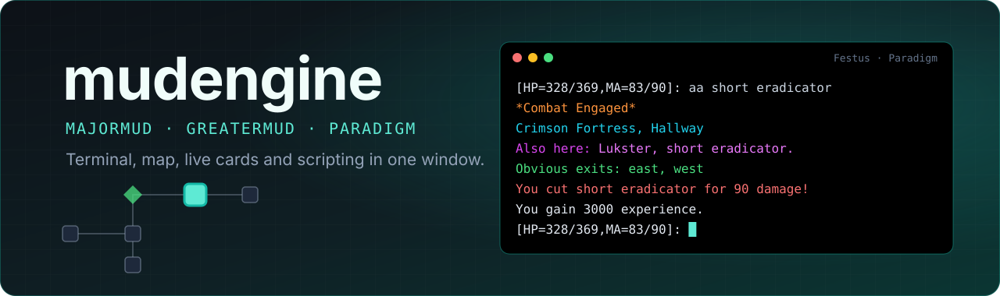
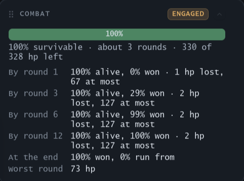
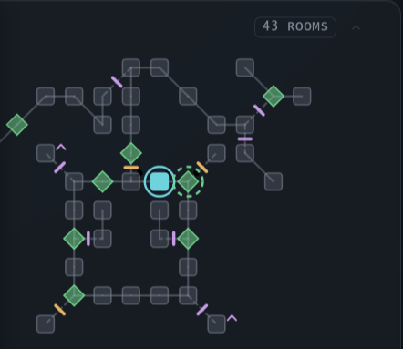
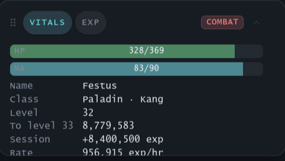
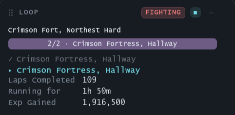
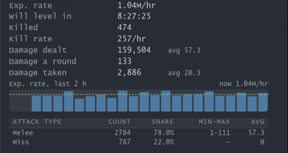
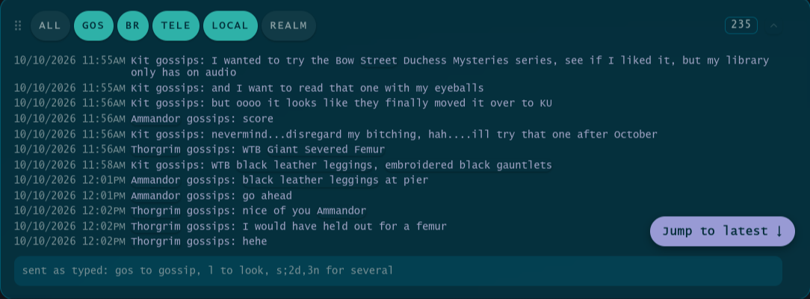
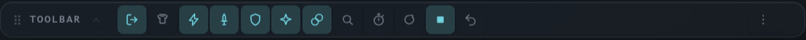
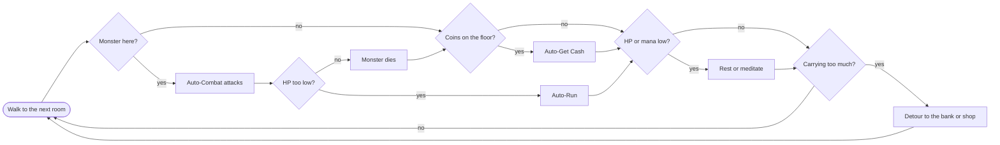
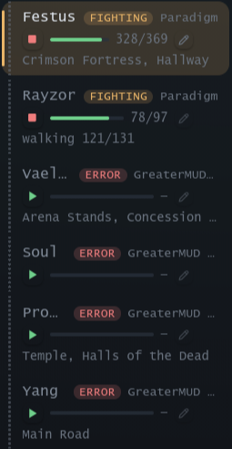

<p align="center">
  
</p>

<p align="center">
  
  
  
  
  
  
</p>

<p align="center">
  <a href="#at-a-glance">At a glance</a> ·
  <a href="#cards">Cards</a> ·
  <a href="#scripting">Scripting</a> ·
  <a href="#walking-loops-and-goto">Loops and goto</a> ·
  <a href="#trips">Trips</a> ·
  <a href="#getting-started">Getting started</a> ·
  <a href="#running-it-in-docker">Docker</a>
</p>

<br>


## At a glance

<table>
<tr>
<td width="33%" valign="top">
<br>
<b>Terminal</b><br>
<sub>The game as the server sends it, ANSI colours and CP437, with backscroll search.</sub>
</td>
<td width="33%" valign="top">
<br>
<b>Live cards</b><br>
<sub>Vitals, inventory, who list, room, party and more, updated from what the server prints.</sub>
</td>
<td width="33%" valign="top">
<br>
<b>Fight odds</b><br>
<sub>Chance to survive, rounds to kill and worst round, before and during every fight.</sub>
</td>
</tr>
<tr>
<td valign="top">
<br>
<b>Map and goto</b><br>
<sub>Built-in world data for MajorMUD and Paradigm. Click a room and walk there.</sub>
</td>
<td valign="top">
<br>
<b>Loops</b><br>
<sub>420 of MegaMUD's paths ship as loops. Draw your own on the map.</sub>
</td>
<td valign="top">
<br>
<b>Scripting</b><br>
<sub>Auto-Combat, spells, rest, run, hangup, sneak, light, cash and more.</sub>
</td>
</tr>
<tr>
<td valign="top">
<br>
<b>Trips</b><br>
<sub>Leaves the loop for the bank, shop, trainer or a gear upgrade, then comes back.</sub>
</td>
<td valign="top">
<br>
<b>Many characters</b><br>
<sub>A tab each, split view, or a window each. Alerts from the ones you are not watching.</sub>
</td>
<td valign="top">
<br>
<b>Remote control</b><br>
<sub>Answers MegaMUD <code>@</code> commands from the players, gang or party you allow.</sub>
</td>
</tr>
</table>

| | |
|---|---|
| Games | MajorMUD, GreaterMUD, Paradigm |
| Runs on | Windows, macOS (Intel and Apple Silicon), Linux, or in a browser through Docker |
| World data | MajorMUD and Paradigm built in, or load your realm's own `.mdb` |
| Realms included | Paradigm's six: game 1 to 4, test PvE, test PvP |
| Status | 0.9.2, played daily on live realms |

## Cards

Each card reads what the server prints and updates as you play, so you are
not typing `st` and `i` over and over. Drag, resize, dock or float any of
them. **Auto layout** sizes each one to fit.

<table>
<tr>
<td width="50%" valign="top">
<br>
<b>Combat</b><br>
<sub>The odds for the fight you are in: chance to survive, rounds to kill, HP left, and the worst round.</sub>
</td>
<td width="50%" valign="top">
<br>
<b>Map</b><br>
<sub>Rooms around you from the world database. Lairs, shops, banks, gates, traps and searched exits are marked.</sub>
</td>
</tr>
<tr>
<td valign="top">
<br>
<b>Vitals</b><br>
<sub>HP and mana or kai, level, exp to next level, session exp and exp rate.</sub>
</td>
<td valign="top">
<br>
<b>Navigation</b><br>
<sub>The loop or route you are on, which stop is next, laps completed and exp gained.</sub>
</td>
</tr>
<tr>
<td colspan="2" valign="top">
<br>
<b>Combat Stats</b><br>
<sub>Exp rate, kill rate, time to level, damage dealt and taken, an exp graph for the last two hours, and hit and miss rates per attack type.</sub>
</td>
</tr>
<tr>
<td colspan="2" valign="top">
<br>
<b>Talk</b><br>
<sub>Gossip, broadcast, telepaths, gangpath, say and yell, each on its own tab with search. Type into it to talk.</sub>
</td>
</tr>
</table>

<details>
<summary><b>Every card</b></summary>
<br>

| | Card | Shows |
|---|---|---|
| 🧍 | Vitals | HP, mana or kai, exp, exp rate. The Exp tab has the full level table. |
| 📜 | Self | Stats, skills, lives/CP, AC/DR, MR, light source, supplies running low. |
| 🎒 | Inventory | What you carry, coins by type, weight, keys. |
| 🛡️ | Gear | The best item for each slot in the realm, what you can afford, and a trip to buy it. |
| 🏦 | Banks | Your balance at every bank you have used. |
| ⚔️ | Combat | Target, how hurt it is, what is on you, and the odds. |
| 📈 | Combat Stats | Exp rate, kills, damage, hit rates, exp graph. |
| 🏹 | Hunting Grounds | Every lair you can reach, rated for this character, best first. |
| 👥 | Party | Members' HP and mana, rank, who is fighting what, invites. |
| 🗺️ | Map | Rooms around you. Click one to goto it. |
| 🚪 | Room | Where you are, what is here, and shop, bank, temple or trainer details. |
| ✏️ | Loop Builder | Click rooms on the map to draw a loop and save it. |
| 🧭 | Navigation | The route or loop you are on, with stop and resume. |
| 🏪 | Shops | Every shop list you have seen, searchable, with a route to each. |
| 📖 | Quest Book | The realm's quests, who can do them, each step and its route. |
| 🔎 | Reference | Any monster, item or spell: HP, drops, price, AC/DR, spell cost. |
| 💬 | Talk | Every channel on its own tab. |
| 🌐 | Realm | The `who` list, filtered by alignment. |
| 🧑‍🤝‍🧑 | Players | Everyone you have seen, where last seen, and `@health` replies. |
| 🏰 | Gang | Gang members and which `@` commands they may use. |
| 🔔 | Alerts | Low HP, arrivals, PvP, hangups, route ends, and your own watches. |
| 🔧 | Session, Link, Automation, Stream | The connection, and every command sent, including what was refused and why. |

</details>

## Scripting

Every switch is on the toolbar and in the character's settings, and each is
off until you turn it on.

<p align="center"></p>



| Switch | What it does |
|---|---|
| Auto-Combat | Attacks by your rules: which monsters to attack or leave alone, the opener (`bs`, `ju`) and the attack each round. |
| Spells | Attack spells, drains when hurt, heals, cures, blesses and buffs, each with a mana floor. |
| Items | Potions and other items, used when HP drops or a condition hits. |
| Rest | Rests or meditates to a set percent or to full before moving on. |
| Auto-Run | Runs from a fight when HP is too low, or between rounds. |
| Auto-Teleport | A last way out when running is not enough. |
| Auto-Hangup | Hangs up as a last resort. It warns you that hanging up while a player is attacking you carries a five-minute penalty. |
| Auto-Sneak · Auto-Light · Auto-Search | Sneaks between rooms, lights dark rooms, searches for hidden exits. |
| Auto-Get Cash · Auto-Drop Junk | Picks up coins and drops what you set as junk. |
| Auto-Bless | Keeps your blesses up. |
| Auto-Gear | Wears the best gear and puts it back on after a fight. |
| Doors | Opens, picks or bashes closed doors on the way. |
| Training | Walks to the trainer and trains when a level is ready. |
| Leading and following | Follows a leader, assists, rests with the leader, joins when invited, heals the party. |
| Attacked by a player | What to do when another player attacks you, and whether to fight back. |
| Away From Keyboard | After a set number of minutes with no typing, answers telepaths with your away reply, such as MegaMUD's `{AFK}`. |

> [!NOTE]
> Before logging in with scripting on, the client asks if your lives are
> below the floor you set.

## Walking, loops and goto

<table>
<tr>
<td width="56" valign="top"></td>
<td><b>Goto</b><br>Go to any room by name or number. The route goes through gates, doors and keys, picks up an item it needs on the way, and shows the fights along it with the odds of each.</td>
</tr>
<tr>
<td valign="top"></td>
<td><b>Loops</b><br>Run lap after lap, forward or backward. 420 of MegaMUD's paths ship as loops. Find one by "starts here", "passes through here" or "last walked", or draw your own with the Loop Builder.</td>
</tr>
<tr>
<td valign="top"></td>
<td><b>Search the area</b><br>Searches every room within a set number of steps for hidden items and exits.</td>
</tr>
<tr>
<td valign="top"></td>
<td><b>Cash run</b><br>Walks a loop picking up coins, banks them, and walks back.</td>
</tr>
</table>

If a step fails or the room is dark, the client reports that it is lost and
resyncs from the next room it recognizes. If a route stops and you are far
from it, the client asks whether to walk back or stay.

## Trips

These work like MegaMUD's detours. The client leaves the loop, does the job,
and comes back.

| | Trip | When |
|:---:|---|---|
|  | Bank | Auto-Deposit, when you carry too many coins. |
|  | Shop | Auto-Buy Supplies when you run low, or to sell. |
|  | Trainer | When a level is ready. |
|  | Gear | Buys the upgrade the Gear card found. |
|  | Quest | Auto-Quest walks a quest's steps from the Quest Book. |

## Remote control

The client answers MegaMUD `@` commands from players you allow, your gang or
your party. The reply goes back on the channel the command came in on.

| Answers | Always refuses |
|---|---|
| `@health` `@do` `@join` `@forget` `@get-all` `@party` `@wait` `@ok` `@relog` | `@kill` `@hangup` |

## More than one character

<table>
<tr>
<td width="200" valign="top"></td>
<td valign="top">

- Each character has its own tab and its own connection.
- The tab shows what it is doing: fighting, resting, walking 121/131,
  looping, poisoned, held, offline.
- Split the window to show two characters side by side or stacked.
- Move any character to its own window, and move it back.
- A character you are not watching still raises alerts, and its tab shows
  them.

</td>
</tr>
</table>

## Settings and files

| | |
|---|---|
|  | <kbd>Ctrl</kbd> <kbd>Shift</kbd> <kbd>K</kbd> opens the command palette: commands, rooms to goto, monsters and items to look up, cards to show. |
|  | Settings has a page for each character, each realm and the client, and **Find a setting** searches all of them. |
|  | Everything is saved as YAML you can edit by hand. The client keeps your comments when it writes. Each realm has its own folder and login script. |
|  | 27 themes, dark and light, such as Dracula, Nord, Gruvbox, Solarized and Vivid VGA. The terminal stays black. |
|  | Desktop notifications, switched on per event. |
|  | Session logs, captures and the talk log are kept on disk. Rewrites change how lines look and set the statline format. |
|  | Extensions are folders with a `manifest.json`, and can add their own card and buttons. |

## Getting started

From source, with Node 20 or later:

```sh
npm install --ignore-scripts
npm run dev
```

| Platform | Build command | You get |
|---|---|---|
|  | `npm run dist:win` | Installer, zip |
|  | `npm run dist:mac` | dmg, zip |
|  | `npm run dist:linux` | AppImage, deb, tar.gz |

On first start, add a character, pick a realm and connect. To use another
realm's world data, point the realm at its `.mdb`. The client converts it the
first time and keeps the result.

## Running it in Docker

The image serves the whole client to your browser. The game connections,
files and scripting run in the container.

```sh
docker run --rm -p 8080:8080 -v mudengine:/config rayzorben/mudengine:latest
```

Open `http://localhost:8080/` and sign in with the password the container
printed the first time it started.

> [!WARNING]
> The connection is not encrypted. If the port is reachable from anywhere
> other than your own machine, put a TLS proxy in front of it and set
> `MUDENGINE_TRUST_PROXY=1`.

<details>
<summary><b>Options and notes</b></summary>
<br>

| Option | Use |
|---|---|
| `-p 8080:8080` | The port your browser connects to. |
| `-v mudengine:/config` | Keeps your settings, realms, characters, logs and password. Without it they are deleted with the container. |
| `-e MUDENGINE_PASSWORD=…` | Sets your own password instead of a generated one. |
| `-e MUDENGINE_TRUST_PROXY=1` | Trusts a TLS proxy in front of the client. |

- The password is printed once and saved to `/config/.access-password`.
  Delete that file to get a new one.
- Only one client can run on the same `/config` at a time.
- A browser tab cannot move a character to its own window.
- The image runs as uid 1000. A bind-mounted folder has to be writable by
  that user. The named volume above needs no setup.
- `npm run docker:build` builds the image and `npm run docker:run` runs it.
  Without Docker, use `npm run build && npm run web`.

</details>

---

<p align="center">
<sub>MIT licence · Icons from <a href="https://fonts.google.com/icons">Material Symbols</a> (Apache 2.0)</sub>
</p>
